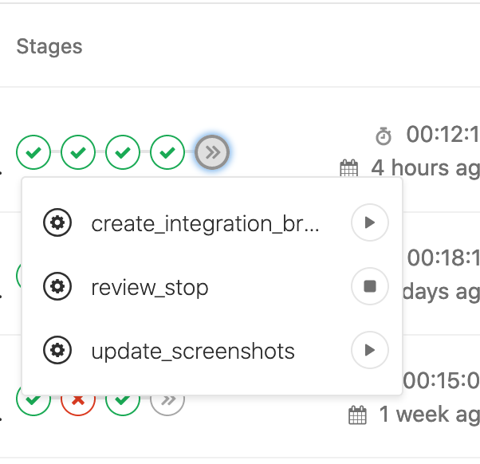

# Adding a new component to KhulnaSoft UI

The following provides guidance for engineers adding new components to KhulnaSoft
UI. Before beginning, please review the [design system contribution
process](https://design.khulnasoft.com/contribute/contributing).

## Merge Request guidelines

Create a Merge Request in KhulnaSoft UI with your new component code. Ensure that
the merge request causes a new minor version of the `@khulnasoft/ui` to be
released.

Run the manual CI job (`update_screenshots`) to generate the baseline snapshots used by the visual
tests. You can find it in last stage of
[KhulnaSoft UI CI pipeline](https://github.com/khulnasoft/khulnasoft-ui/actions).
This CI job commits the baseline snapshot images to the merge request branch.

### How to keep merge requests small

New components are usually introduced in a single, large MR.

To simplify the review process, create a principal feature branch based on the project's main branch.
Then, create smaller branches targeting the principal branch to iterate through smaller changes.

## Testing your new component in KhulnaSoft

This section has moved to [Testing GitlLab UI changes in KhulnaSoft](./khulnasoft_integration_test.md).
